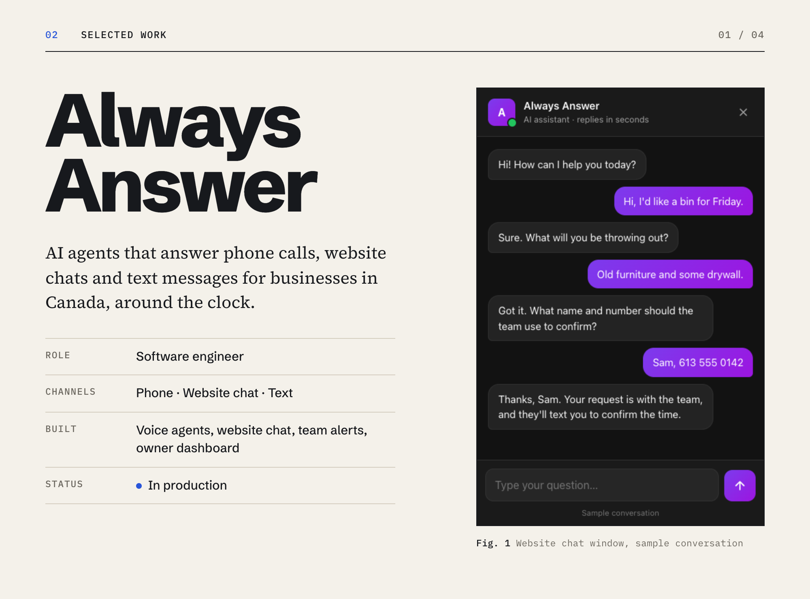
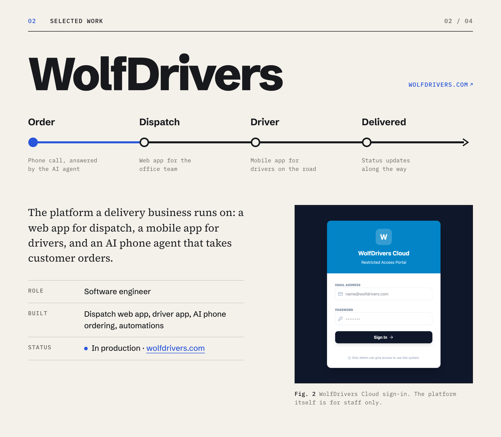
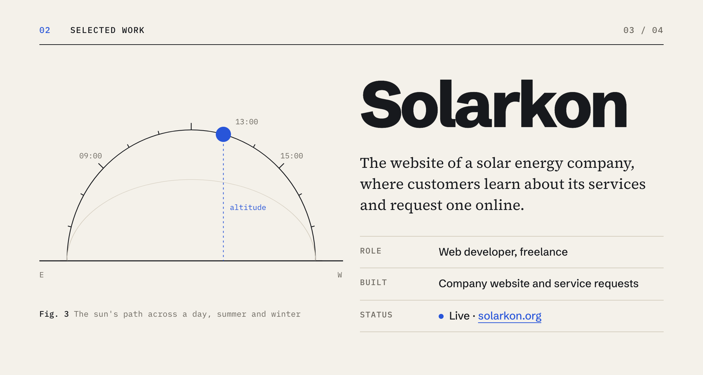
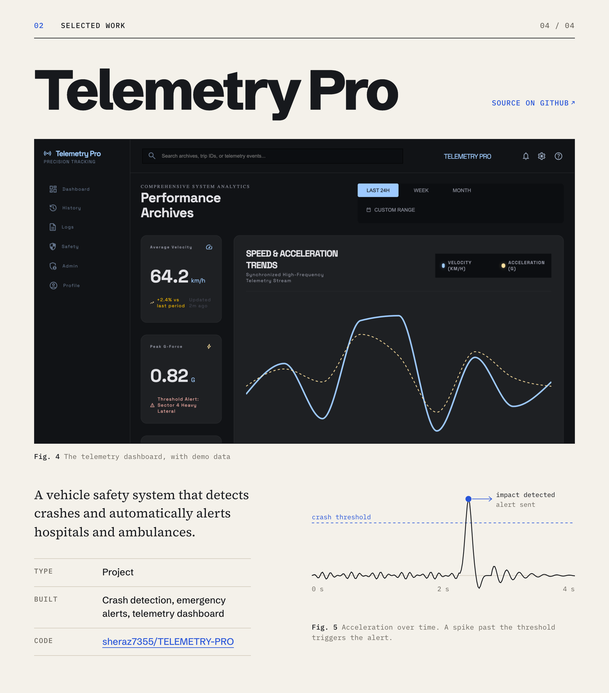
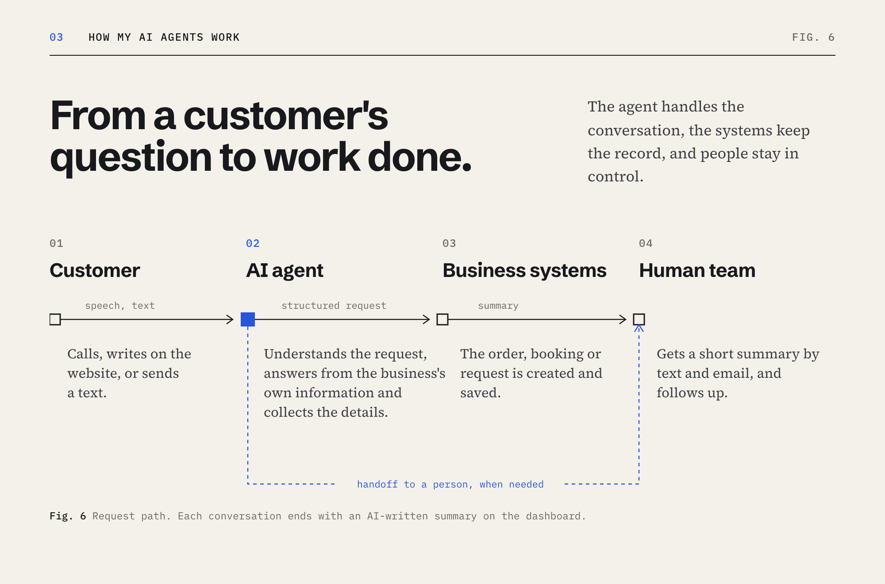
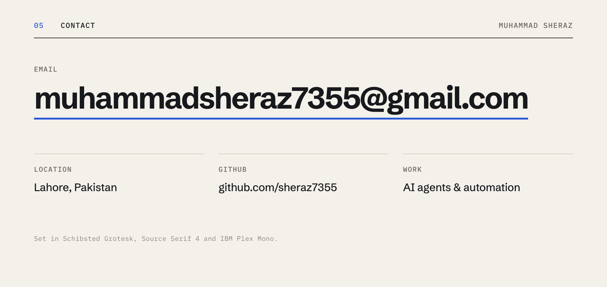

<!--
  Profile artwork. Built from site/index.html (sections) and build/hero.cjs (opening banner): npm run build.
  Screens narrower than 600 px get the phone versions (assets/hero-m.svg, assets/plates/m/).
-->

<picture>
  <source media="(max-width: 600px)" srcset="https://raw.githubusercontent.com/sheraz7355/sheraz7355/main/assets/hero-m.svg">
  
</picture>

<picture>
  <source media="(max-width: 600px)" srcset="https://raw.githubusercontent.com/sheraz7355/sheraz7355/main/assets/plates/m/about.png">
  
</picture>

<picture>
  <source media="(max-width: 600px)" srcset="https://raw.githubusercontent.com/sheraz7355/sheraz7355/main/assets/plates/m/work-1-always-answer.png">
  
</picture>

<a href="https://wolfdrivers.com">
<picture>
  <source media="(max-width: 600px)" srcset="https://raw.githubusercontent.com/sheraz7355/sheraz7355/main/assets/plates/m/work-2-wolfdrivers.png">
  
</picture>
</a>

<a href="http://solarkon.org">
<picture>
  <source media="(max-width: 600px)" srcset="https://raw.githubusercontent.com/sheraz7355/sheraz7355/main/assets/plates/m/work-3-solarkon.png">
  
</picture>
</a>

<a href="https://github.com/sheraz7355/TELEMETRY-PRO">
<picture>
  <source media="(max-width: 600px)" srcset="https://raw.githubusercontent.com/sheraz7355/sheraz7355/main/assets/plates/m/work-4-telemetry-pro.png">
  
</picture>
</a>

<picture>
  <source media="(max-width: 600px)" srcset="https://raw.githubusercontent.com/sheraz7355/sheraz7355/main/assets/plates/m/process.png">
  
</picture>

<picture>
  <source media="(max-width: 600px)" srcset="https://raw.githubusercontent.com/sheraz7355/sheraz7355/main/assets/plates/m/now.png">
  
</picture>

<a href="mailto:muhammadsheraz7355@gmail.com">
<picture>
  <source media="(max-width: 600px)" srcset="https://raw.githubusercontent.com/sheraz7355/sheraz7355/main/assets/plates/m/contact.png">
  
</picture>
</a>

<a href="mailto:muhammadsheraz7355@gmail.com">muhammadsheraz7355@gmail.com</a> &nbsp;·&nbsp; Lahore, Pakistan

