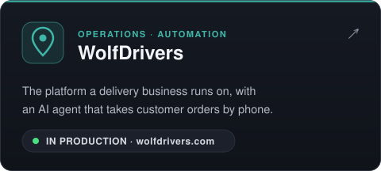
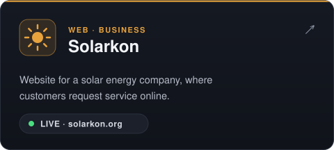
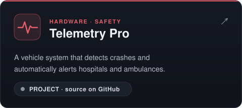
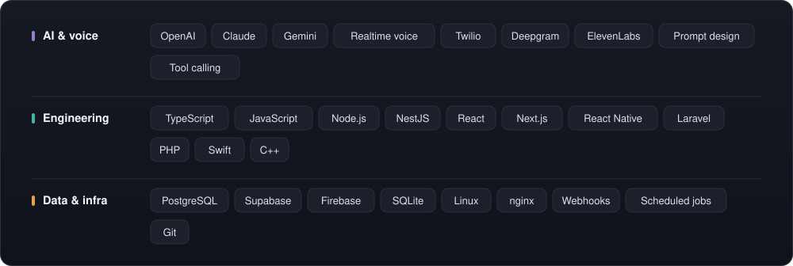

  

## Hi, I'm Sheraz 👋

I turn the repetitive parts of a business into **AI agents and automations**: answering customers on the phone,
website chat and text, taking orders, routing messages, and handing the team a ready-to-act summary.
What you see below runs for real businesses, every day.

  

## What I've built

  
  

  
  

## Right now

- 🎙️ Making AI phone agents sound more natural and answer faster
- ⚙️ Automating the office work of a delivery business
- 🎓 BS Computer Science at ARID University, Lahore (CGPA 3.83/4)

## Toolbox

  

## Say hi

📫 [muhammadsheraz7355@gmail.com](mailto:muhammadsheraz7355@gmail.com) · 📍 Lahore, Pakistan
