<!--
  Built by `npm run build` from build/*.cjs. Every picture comes in four versions (light/dark theme, desktop/phone).
  The moving dots are CSS animations inside the SVGs; screenshots are in site/shots/ (sample data only).
-->

<picture>
  <source media="(max-width: 600px) and (prefers-color-scheme: dark)" srcset="https://raw.githubusercontent.com/sheraz7355/sheraz7355/main/assets/night/m/hero.svg">
  <source media="(max-width: 600px)" srcset="https://raw.githubusercontent.com/sheraz7355/sheraz7355/main/assets/day/m/hero.svg">
  <source media="(prefers-color-scheme: dark)" srcset="https://raw.githubusercontent.com/sheraz7355/sheraz7355/main/assets/night/hero.svg">
  
</picture>

<a href="mailto:muhammadsheraz7355@gmail.com"><picture>  <source media="(prefers-color-scheme: dark)" srcset="https://raw.githubusercontent.com/sheraz7355/sheraz7355/main/assets/night/btn-email.svg">  </picture></a>&nbsp;&nbsp;
<a href="https://github.com/sheraz7355?tab=repositories"><picture>  <source media="(prefers-color-scheme: dark)" srcset="https://raw.githubusercontent.com/sheraz7355/sheraz7355/main/assets/night/btn-repos.svg">  </picture></a>

<picture>
  <source media="(max-width: 600px) and (prefers-color-scheme: dark)" srcset="https://raw.githubusercontent.com/sheraz7355/sheraz7355/main/assets/night/m/about.svg">
  <source media="(max-width: 600px)" srcset="https://raw.githubusercontent.com/sheraz7355/sheraz7355/main/assets/day/m/about.svg">
  <source media="(prefers-color-scheme: dark)" srcset="https://raw.githubusercontent.com/sheraz7355/sheraz7355/main/assets/night/about.svg">
  
</picture>

<picture>
  <source media="(max-width: 600px) and (prefers-color-scheme: dark)" srcset="https://raw.githubusercontent.com/sheraz7355/sheraz7355/main/assets/night/m/work.svg">
  <source media="(max-width: 600px)" srcset="https://raw.githubusercontent.com/sheraz7355/sheraz7355/main/assets/day/m/work.svg">
  <source media="(prefers-color-scheme: dark)" srcset="https://raw.githubusercontent.com/sheraz7355/sheraz7355/main/assets/night/work.svg">
  
</picture>

<picture>
  <source media="(max-width: 600px) and (prefers-color-scheme: dark)" srcset="https://raw.githubusercontent.com/sheraz7355/sheraz7355/main/assets/night/m/ai-receptionist.svg">
  <source media="(max-width: 600px)" srcset="https://raw.githubusercontent.com/sheraz7355/sheraz7355/main/assets/day/m/ai-receptionist.svg">
  <source media="(prefers-color-scheme: dark)" srcset="https://raw.githubusercontent.com/sheraz7355/sheraz7355/main/assets/night/ai-receptionist.svg">
  
</picture>

<picture>
  <source media="(max-width: 600px) and (prefers-color-scheme: dark)" srcset="https://raw.githubusercontent.com/sheraz7355/sheraz7355/main/assets/night/m/shots-ai-receptionist.jpg">
  <source media="(max-width: 600px)" srcset="https://raw.githubusercontent.com/sheraz7355/sheraz7355/main/assets/day/m/shots-ai-receptionist.jpg">
  <source media="(prefers-color-scheme: dark)" srcset="https://raw.githubusercontent.com/sheraz7355/sheraz7355/main/assets/night/shots-ai-receptionist.jpg">
  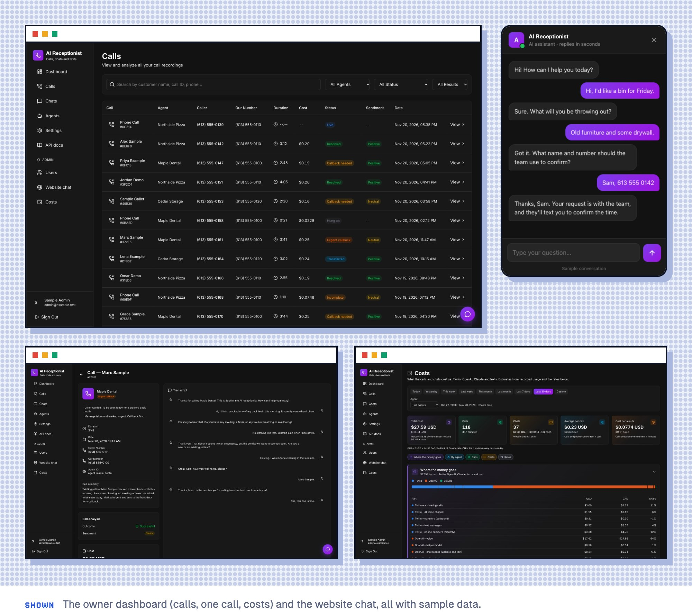
</picture>

<a href="https://github.com/sheraz7355/Sulehri">
<picture>
  <source media="(max-width: 600px) and (prefers-color-scheme: dark)" srcset="https://raw.githubusercontent.com/sheraz7355/sheraz7355/main/assets/night/m/sulehri.svg">
  <source media="(max-width: 600px)" srcset="https://raw.githubusercontent.com/sheraz7355/sheraz7355/main/assets/day/m/sulehri.svg">
  <source media="(prefers-color-scheme: dark)" srcset="https://raw.githubusercontent.com/sheraz7355/sheraz7355/main/assets/night/sulehri.svg">
  
</picture>
</a>

<a href="https://github.com/sheraz7355/Sulehri">
<picture>
  <source media="(max-width: 600px) and (prefers-color-scheme: dark)" srcset="https://raw.githubusercontent.com/sheraz7355/sheraz7355/main/assets/night/m/shots-sulehri.jpg">
  <source media="(max-width: 600px)" srcset="https://raw.githubusercontent.com/sheraz7355/sheraz7355/main/assets/day/m/shots-sulehri.jpg">
  <source media="(prefers-color-scheme: dark)" srcset="https://raw.githubusercontent.com/sheraz7355/sheraz7355/main/assets/night/shots-sulehri.jpg">
  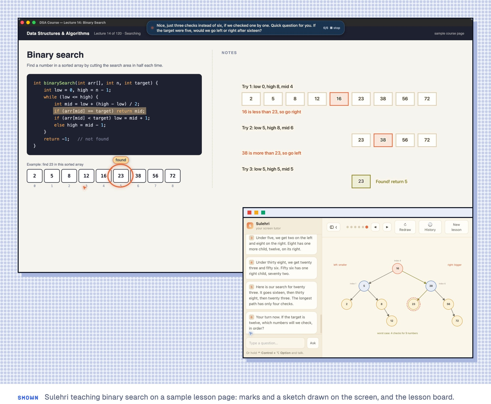
</picture>
</a>

<picture>
  <source media="(max-width: 600px) and (prefers-color-scheme: dark)" srcset="https://raw.githubusercontent.com/sheraz7355/sheraz7355/main/assets/night/m/delivery-platform.svg">
  <source media="(max-width: 600px)" srcset="https://raw.githubusercontent.com/sheraz7355/sheraz7355/main/assets/day/m/delivery-platform.svg">
  <source media="(prefers-color-scheme: dark)" srcset="https://raw.githubusercontent.com/sheraz7355/sheraz7355/main/assets/night/delivery-platform.svg">
  
</picture>

<picture>
  <source media="(max-width: 600px) and (prefers-color-scheme: dark)" srcset="https://raw.githubusercontent.com/sheraz7355/sheraz7355/main/assets/night/m/shots-delivery-platform.jpg">
  <source media="(max-width: 600px)" srcset="https://raw.githubusercontent.com/sheraz7355/sheraz7355/main/assets/day/m/shots-delivery-platform.jpg">
  <source media="(prefers-color-scheme: dark)" srcset="https://raw.githubusercontent.com/sheraz7355/sheraz7355/main/assets/night/shots-delivery-platform.jpg">
  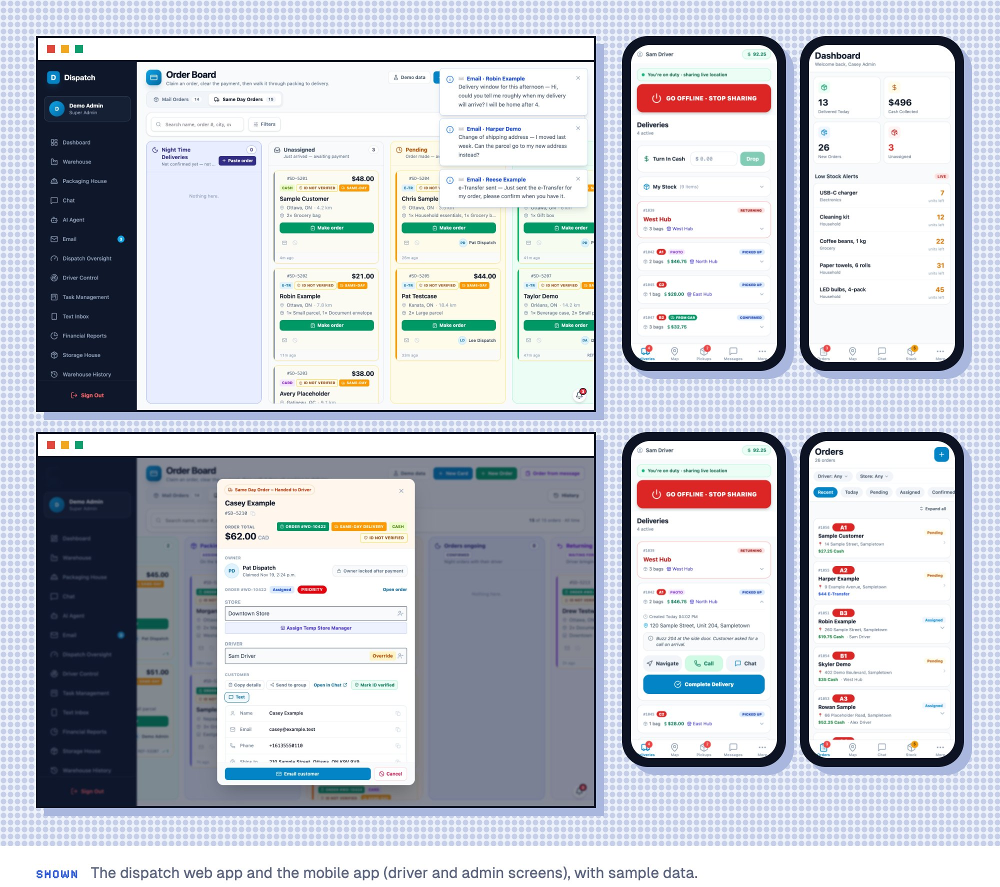
</picture>

<a href="http://solarkon.org">
<picture>
  <source media="(max-width: 600px) and (prefers-color-scheme: dark)" srcset="https://raw.githubusercontent.com/sheraz7355/sheraz7355/main/assets/night/m/solarkon.svg">
  <source media="(max-width: 600px)" srcset="https://raw.githubusercontent.com/sheraz7355/sheraz7355/main/assets/day/m/solarkon.svg">
  <source media="(prefers-color-scheme: dark)" srcset="https://raw.githubusercontent.com/sheraz7355/sheraz7355/main/assets/night/solarkon.svg">
  
</picture>
</a>

<a href="http://solarkon.org">
<picture>
  <source media="(max-width: 600px) and (prefers-color-scheme: dark)" srcset="https://raw.githubusercontent.com/sheraz7355/sheraz7355/main/assets/night/m/shots-solarkon.jpg">
  <source media="(max-width: 600px)" srcset="https://raw.githubusercontent.com/sheraz7355/sheraz7355/main/assets/day/m/shots-solarkon.jpg">
  <source media="(prefers-color-scheme: dark)" srcset="https://raw.githubusercontent.com/sheraz7355/sheraz7355/main/assets/night/shots-solarkon.jpg">
  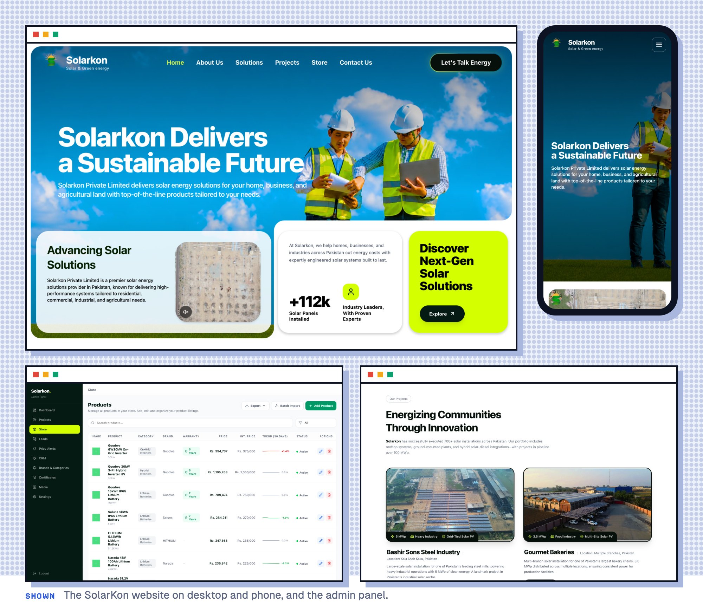
</picture>
</a>

<a href="https://github.com/sheraz7355/TELEMETRY-PRO">
<picture>
  <source media="(max-width: 600px) and (prefers-color-scheme: dark)" srcset="https://raw.githubusercontent.com/sheraz7355/sheraz7355/main/assets/night/m/telemetry-pro.svg">
  <source media="(max-width: 600px)" srcset="https://raw.githubusercontent.com/sheraz7355/sheraz7355/main/assets/day/m/telemetry-pro.svg">
  <source media="(prefers-color-scheme: dark)" srcset="https://raw.githubusercontent.com/sheraz7355/sheraz7355/main/assets/night/telemetry-pro.svg">
  
</picture>
</a>

<a href="https://github.com/sheraz7355/TELEMETRY-PRO">
<picture>
  <source media="(max-width: 600px) and (prefers-color-scheme: dark)" srcset="https://raw.githubusercontent.com/sheraz7355/sheraz7355/main/assets/night/m/shots-telemetry-pro.jpg">
  <source media="(max-width: 600px)" srcset="https://raw.githubusercontent.com/sheraz7355/sheraz7355/main/assets/day/m/shots-telemetry-pro.jpg">
  <source media="(prefers-color-scheme: dark)" srcset="https://raw.githubusercontent.com/sheraz7355/sheraz7355/main/assets/night/shots-telemetry-pro.jpg">
  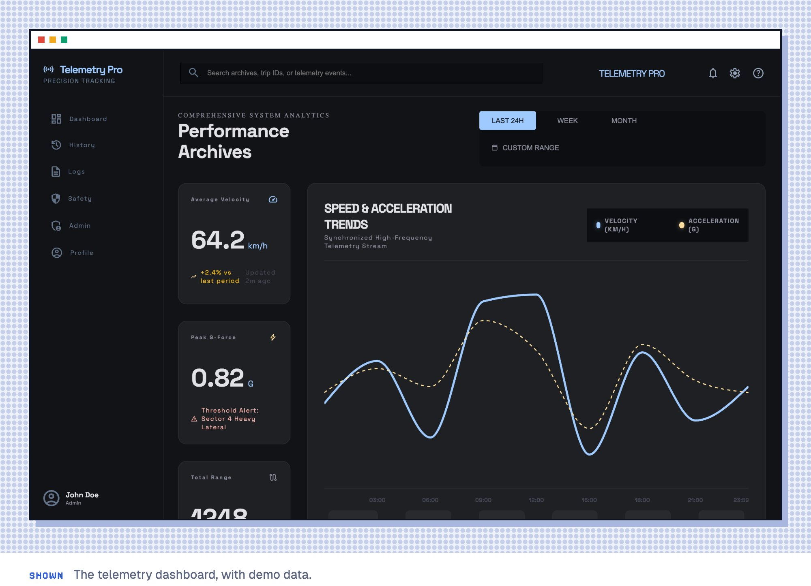
</picture>
</a>

<picture>
  <source media="(max-width: 600px) and (prefers-color-scheme: dark)" srcset="https://raw.githubusercontent.com/sheraz7355/sheraz7355/main/assets/night/m/process.svg">
  <source media="(max-width: 600px)" srcset="https://raw.githubusercontent.com/sheraz7355/sheraz7355/main/assets/day/m/process.svg">
  <source media="(prefers-color-scheme: dark)" srcset="https://raw.githubusercontent.com/sheraz7355/sheraz7355/main/assets/night/process.svg">
  
</picture>

<picture>
  <source media="(max-width: 600px) and (prefers-color-scheme: dark)" srcset="https://raw.githubusercontent.com/sheraz7355/sheraz7355/main/assets/night/m/toolbox.svg">
  <source media="(max-width: 600px)" srcset="https://raw.githubusercontent.com/sheraz7355/sheraz7355/main/assets/day/m/toolbox.svg">
  <source media="(prefers-color-scheme: dark)" srcset="https://raw.githubusercontent.com/sheraz7355/sheraz7355/main/assets/night/toolbox.svg">
  
</picture>

<a href="mailto:muhammadsheraz7355@gmail.com">
<picture>
  <source media="(max-width: 600px) and (prefers-color-scheme: dark)" srcset="https://raw.githubusercontent.com/sheraz7355/sheraz7355/main/assets/night/m/contact.svg">
  <source media="(max-width: 600px)" srcset="https://raw.githubusercontent.com/sheraz7355/sheraz7355/main/assets/day/m/contact.svg">
  <source media="(prefers-color-scheme: dark)" srcset="https://raw.githubusercontent.com/sheraz7355/sheraz7355/main/assets/night/contact.svg">
  
</picture>
</a>

<a href="mailto:muhammadsheraz7355@gmail.com">muhammadsheraz7355@gmail.com</a> &nbsp;·&nbsp; Lahore, Pakistan

